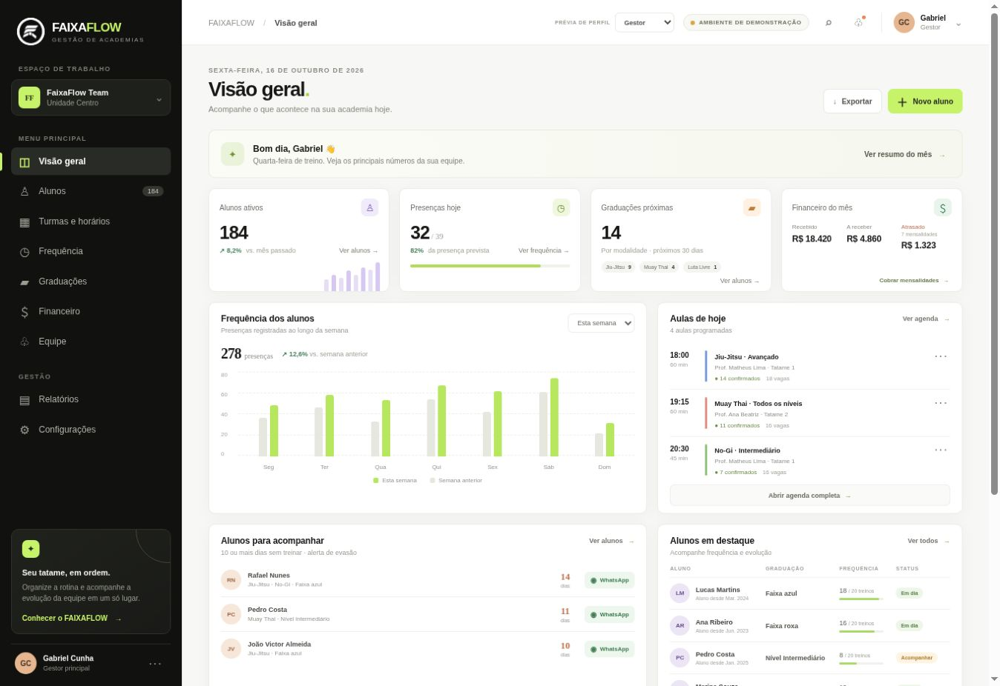

# FAIXAFLOW

Protótipo de painel web para gestão de academias e equipes de artes marciais.

## Demonstração online

[Abrir FAIXAFLOW no GitHub Pages](https://gabrielaffonsocunha.github.io/faixaflow/)

## Executar localmente

Abra `index.html` em um navegador. Não há etapa de build nem dependências externas.

## O que o protótipo demonstra

- Visão do gestor com valores recebidos, a receber e mensalidades atrasadas.
- Alerta de alunos sem treinar há 10 dias ou mais, com atalho para WhatsApp.
- Graduação vinculada à modalidade do aluno.
- Frequência dos alunos.
- Prévia do painel de professor, focada em turmas do dia, chamada e alunos aptos a graduar.

## Limitações

Esta versão é uma demonstração visual com dados ilustrativos. Não possui autenticação real, banco de dados, persistência dos cadastros, integração de pagamentos ou envio de mensagens.
